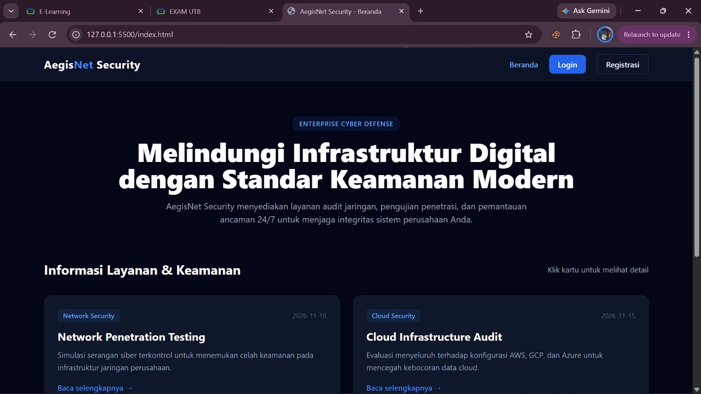
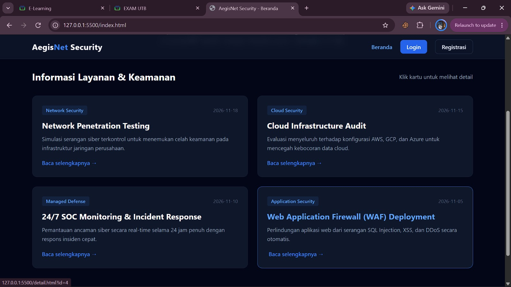
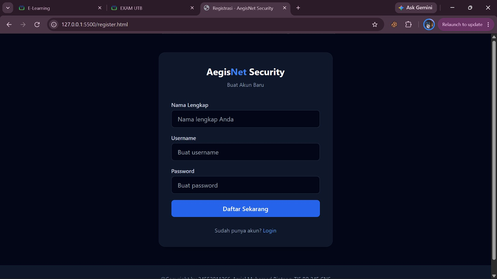
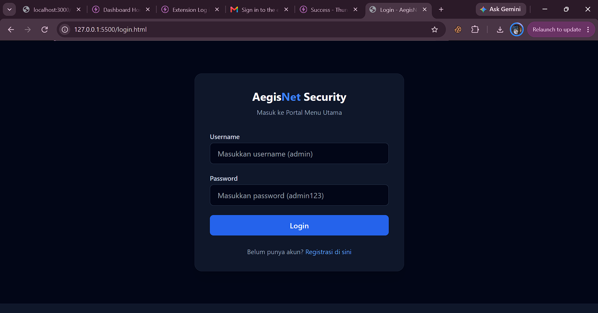
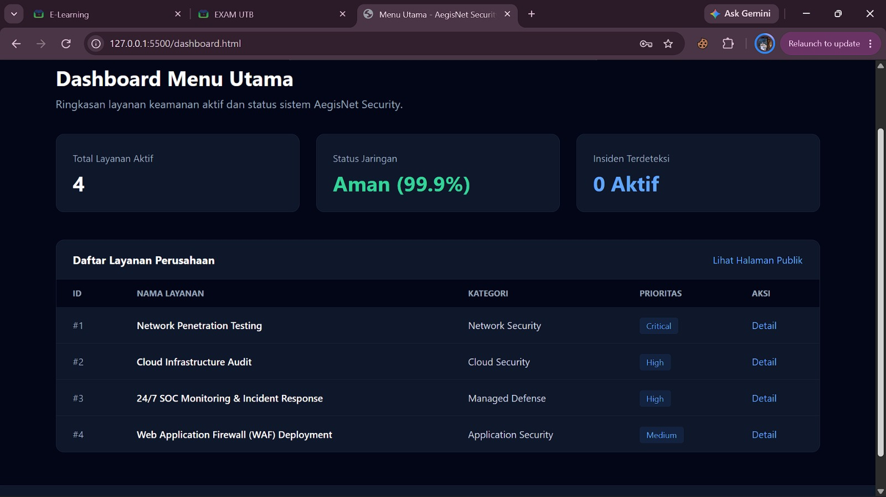
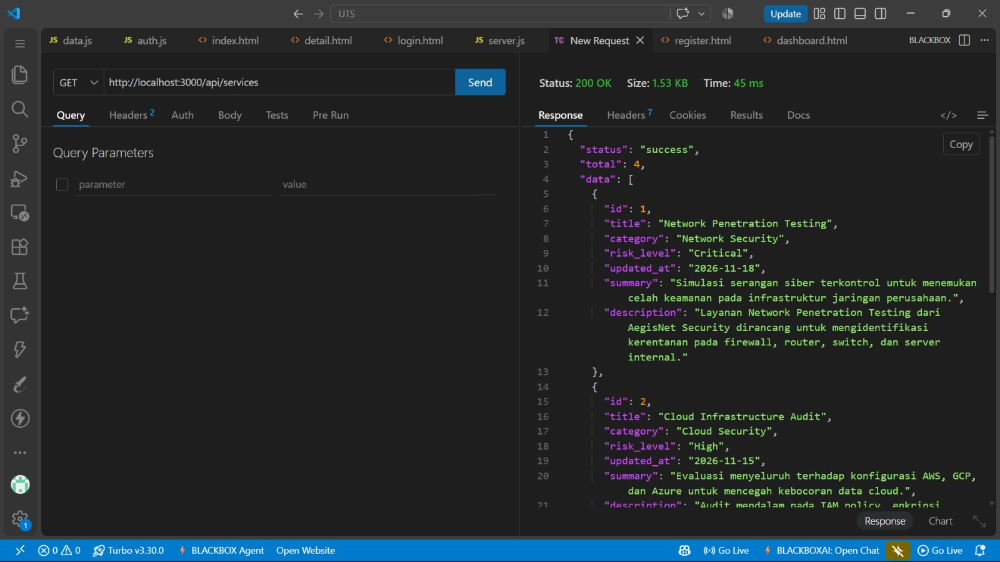
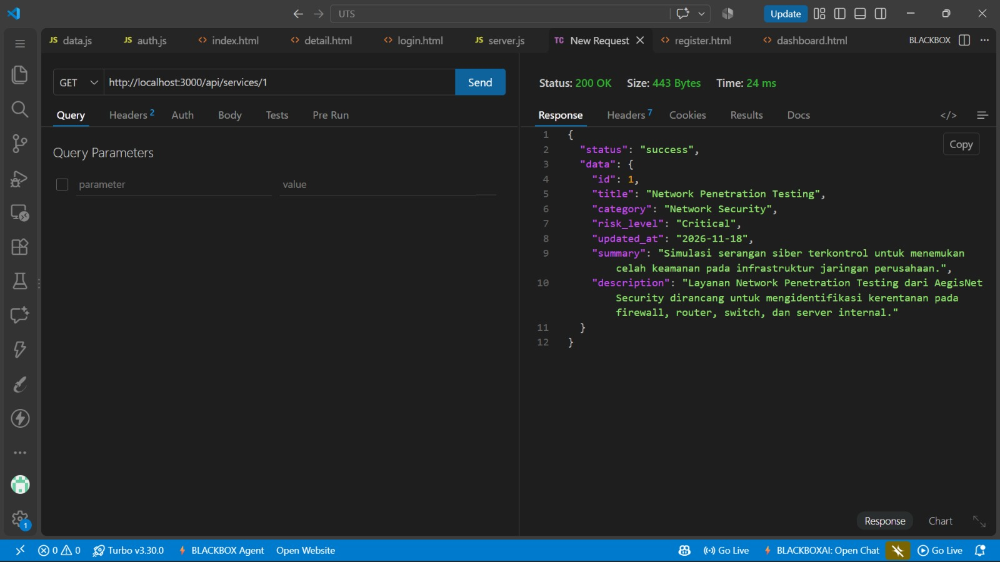
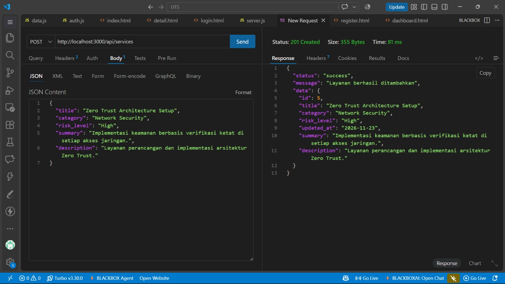
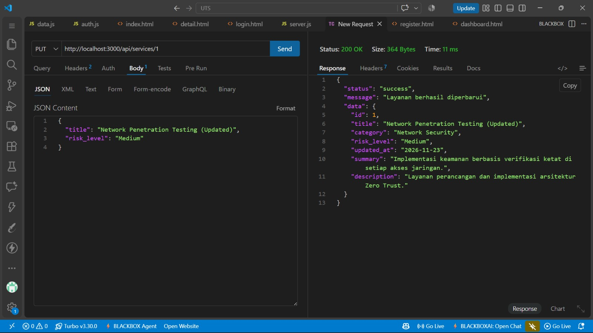
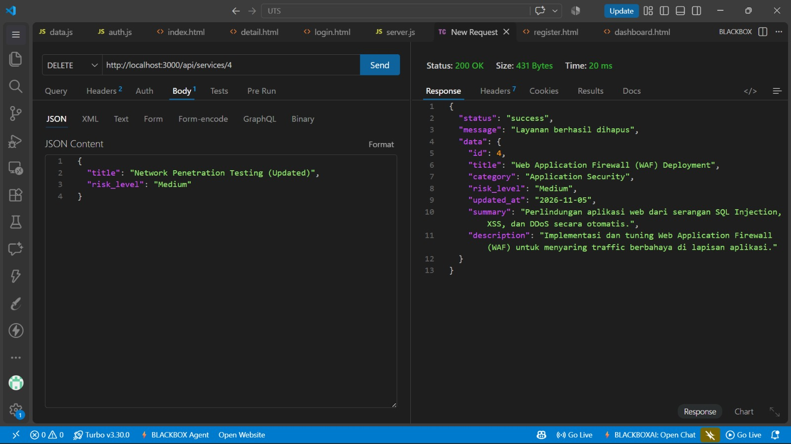

# UTS Pemrograman - AegisNet Security (Web & CRUD API)

**Identitas Mahasiswa:**
- **Nama:** Azriel Muhamad Bintang
- **NPM:** 24552011266
- **Kelas:** TIF RP 24E CNS

---

## Deskripsi Project

Repository ini berisi dua project terintegrasi untuk perusahaan **AegisNet Security**:
1. **Project 1 (Frontend Web):** Website profil dan informasi layanan keamanan siber menggunakan **Tailwind CSS** dan **JavaScript** (dilengkapi halaman utama, detail informasi dinamis, registrasi, validasi login dengan percabangan `if`, serta halaman menu utama/dashboard).
2. **Project 2 (Backend CRUD API):** RESTful API menggunakan **Node.js & Express.js** yang mengelola data layanan perusahaan sesuai data dummy pada Project 1.

### Akun Login Default (Project 1)
- **Username:** `admin`
- **Password:** `admin123`

### Endpoint CRUD API (Project 2)
- `GET /api/services` — Menampilkan seluruh data layanan
- `GET /api/services/:id` — Menampilkan detail layanan berdasarkan ID
- `POST /api/services` — Menambahkan data layanan baru
- `PUT /api/services/:id` — Memperbarui data layanan berdasarkan ID
- `DELETE /api/services/:id` — Menghapus data layanan berdasarkan ID

---

## Screenshot Hasil Project 1 (Website)

### 1. Halaman Utama

### 2. Halaman Detail Informasi

### 3. Halaman Registrasi

### 4. Halaman Login

### 5. Halaman Menu Utama (Dashboard)

---

## Screenshot Hasil Uji Project 2 (CRUD API)

### 1. GET All Services

### 2. GET Service by ID

### 3. POST Create Service

### 4. PUT Update Service

### 5. DELETE Service
